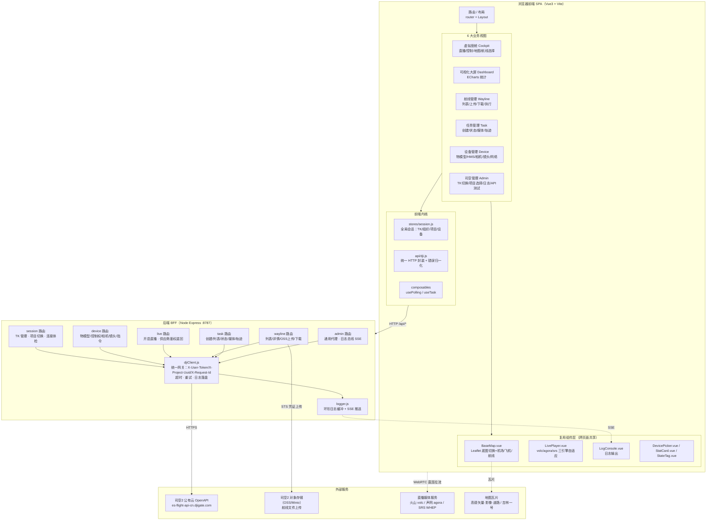
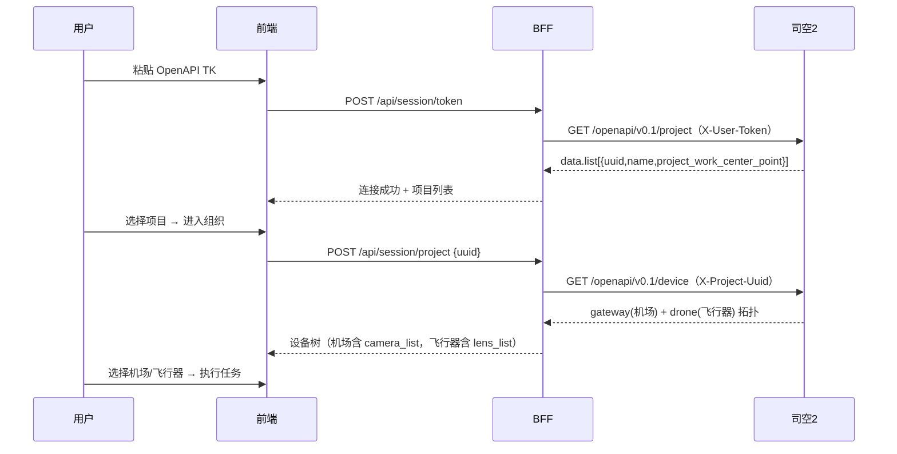
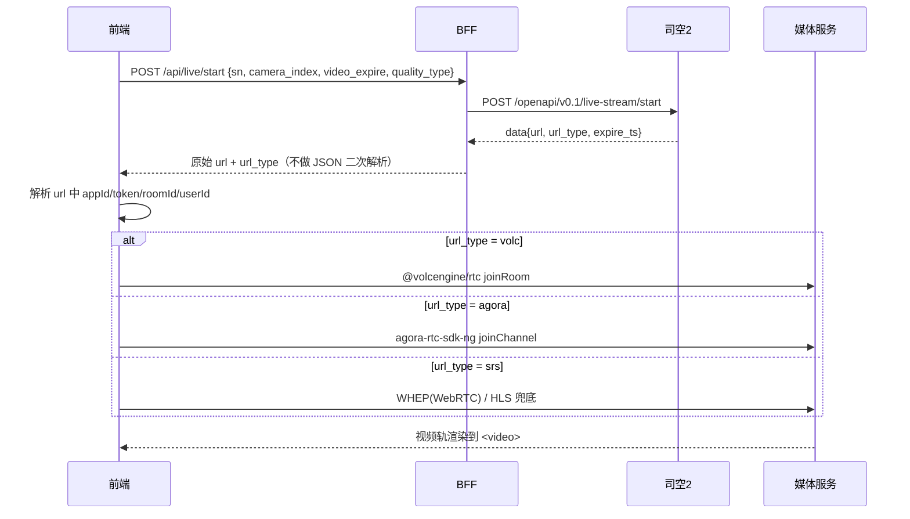
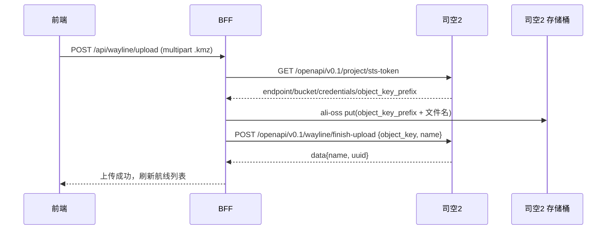

# 大疆司空 2 OpenAPI 无人机管理与控制平台 · 架构设计

> 文档版本：v1.0 ｜ 对接标准：全新司空 2 OpenAPI V1.0（https://fh2-api.apifox.cn/llms.txt）
> 接入点：公有云国内 `https://es-flight-api-cn.djigate.com`，所有业务路径前缀 `/openapi/v0.1`

---

## 一、总体架构图



---

## 二、分层职责

| 层 | 目录 | 职责 | 关键约束 |
|---|---|---|---|
| 视图层 | `web/src/views` | 六大业务页面，只做交互与展示 | 不直接拼 Header，一律走 api 层 |
| 组件层 | `web/src/components` | 地图/播放器/日志/选择器，**跨页复用** | 纯 props 输入、事件输出，无业务耦合 |
| 状态层 | `web/src/stores/session.js` | 当前 TK、组织、项目 UUID、设备树 | 全局单例，切换 TK/项目自动广播刷新 |
| API 层 | `web/src/api/dji.js` | 统一请求、错误归一化、日志上报 | 后端返回非 JSON 时给出可读报错 |
| BFF 路由 | `server/src/routes` | 按业务聚合、参数校验、字段裁剪 | 严格按 Apifox 文档拼装 |
| 网关客户端 | `server/src/djiClient.js` | 注入鉴权头、超时、日志 | `X-User-Token` / `X-Project-Uuid` / `X-Request-Id` / `X-Language` |
| 日志总线 | `server/src/logger.js` | 环形缓冲（默认 500 条）+ SSE | 司空管理页实时可见 |

---

## 三、核心业务时序

### 3.1 接入流程（必须按序）



### 3.2 直播拉流（多供应商自适应）



### 3.3 航线上传（STS 直传）



---

## 四、目录结构

```
dome/
├── ARCHITECTURE.md          ← 本文件
├── README.md                ← 启动与排障手册
├── docs/                    ← 设计文档（api/ 已随脱敏排除，请查官方 Apifox）
├── server/                  ← BFF 代理服务 :8787
│   └── src/
│       ├── index.js         应用入口、路由挂载、SSE
│       ├── djiClient.js     司空2 统一网关客户端
│       ├── logger.js        日志环形缓冲 + SSE 推送
│       ├── store.js         TK 列表持久化（server/data/tokens.json）
│       └── routes/          session/device/live/wayline/task/admin
└── web/                     ← 前端 SPA :5173
    └── src/
        ├── api/dji.js       统一 HTTP + 错误归一化
        ├── stores/session.js 全局会话（TK/项目/设备）
        ├── components/      BaseMap / LivePlayer / LogConsole / ...
        └── views/           Cockpit / Dashboard / Wayline / Task / Device / Admin
```

---

## 五、已识别的历史问题与架构级修复

| 现象 | 根因 | 架构级修复 |
|---|---|---|
| 开启直播报 `Unexpected non-whitespace character after JSON at position 4` | 前端对非 JSON 响应（HTML 错误页/空体）直接 `JSON.parse` | BFF 统一 `safeParse`：先取文本，解析失败时返回原文片段 + HTTP 状态，前端永远拿到结构化错误 |
| 控制权释放 `internal server error` | 释放是 **DELETE + JSON Body**，误用 GET/POST 或未带 body | `djiClient` 支持 `deleteWithBody`，路由层强制走 DELETE |
| 控制权获取 `Bad Request` | `drone_sn` 传成机场 SN，或 `payload_index` 非数组 | 设备树区分 gateway/drone，UI 只允许选飞行器 SN；payload_index 强制数组 |
| 只拿到机场、没有飞行器 | 只读了 airport 类设备 | 组织设备列表同时解析 `gateway` 与 `drone` 两级，飞行器需开机才有 camera_list |
| 地图不显示机场/飞机位置 | 设备列表接口不含坐标 | 坐标取自 **物模型** `/device/{sn}/state`：机场 `device_state.latitude/longitude`，飞行器 `device_state.latitude/longitude/home_latitude/home_longitude` |
| 地图组件丢失/位置异常 | 容器高度为 0、未 invalidateSize | BaseMap 统一 `ResizeObserver + invalidateSize`，首次有坐标自动 fitBounds |
| 航线/大屏 UI 异常 | 布局与数据未解耦 | 统一 Card/Stat 布局与空状态，数据缺失时显示骨架而非塌陷 |

---

## 六、接口对接清单（严格按文档）

| 模块 | 方法 | 路径 | 说明 |
|---|---|---|---|
| 系统 | GET | `/openapi/v0.1/system/status`(见文档) | 连通性体检 |
| 组织项目 | GET | `/openapi/v0.1/project` | 项目列表，`usage=simple` 不分页 |
| 组织项目 | GET | `/openapi/v0.1/device` | 组织设备（gateway+drone） |
| 组织项目 | GET | `/openapi/v0.1/project/device` | 项目设备列表 |
| 组织项目 | GET | `/openapi/v0.1/project/sts-token` | 存储上传凭证 |
| 设备管理 | GET | `/openapi/v0.1/device/{sn}/state` | 物模型（含经纬度） |
| 设备管理 | GET | `/openapi/v0.1/device/hms` | HMS 异常信息 |
| 设备管理 | POST | `/openapi/v0.1/device/control` | 控制权获取 |
| 设备管理 | DELETE | `/openapi/v0.1/device/control` | 控制权释放（带 body） |
| 设备管理 | POST | `/openapi/v0.1/device/change-camera` | 机场舱内/舱外相机 |
| 设备管理 | POST | `/openapi/v0.1/device/change-lens` | 飞行器 wide/zoom/ir |
| 设备管理 | PUT | `/openapi/v0.1/device/stream/quality` | 图传清晰度 |
| 设备管理 | POST | `/openapi/v0.1/device/{sn}/command` | 返航/暂停/恢复 |
| 直播 | POST | `/openapi/v0.1/live-stream/start` | 开启直播 |
| 航线 | GET | `/openapi/v0.1/wayline` | 航线列表 |
| 航线 | GET | `/openapi/v0.1/wayline/{id}` | 航线详情（下载链接） |
| 航线 | POST | `/openapi/v0.1/wayline/finish-upload` | 上传完成通知 |
| 任务 | POST | `/openapi/v0.1/flight-task` | 创建任务 |
| 任务 | GET | `/openapi/v0.1/flight-task/list` | 任务列表 |
| 任务 | GET | `/openapi/v0.1/flight-task/{uuid}` | 任务详情 |
| 任务 | PUT | `/openapi/v0.1/flight-task/{uuid}/status` | 挂起/恢复 |
| 任务 | GET | `/openapi/v0.1/flight-task/{uuid}/media` | 媒体资源 |
| 任务 | GET | `/openapi/v0.1/flight-task/{uuid}/track` | 飞行轨迹 |

---

## 七、真实环境联调结论（2026-09-23 实测）

| 发现 | 影响 | 平台处理 |
|---|---|---|
| `usage=simple` 查询项目会漏项目（返回 2/4） | 项目下拉不全 | 改为 `page=1&page_size=100` 分页全量拉取 |
| 物模型 `/device/{sn}/state` 必须 `X-Project-Uuid` 与设备所属项目一致 | 不带项目头 → `200403 Forbidden`；项目不匹配 → `device_state` 为空（这正是"地图无机场位置"的根因） | 新增 `/session/devices-with-project`：遍历项目聚合设备并标注归属项目，物模型请求自动携带正确项目头 |
| 设备绑定项目接口 `v1.0/manage/.../active-project` 公有云 404 | 私有云专用 | 保留路由，标注仅私有云可用；公有云请在司空 2 控制台绑定 |
| 开启直播返回的 `url` 不是 http 地址，而是鉴权参数串：`app_id=..&room_id=..&token=..&user_id=..`（`url_type=volc`） | 直接 `new URL()` 解析失败（历史直播失败根因之一） | `parseStreamParams` 同时支持 http URL 与参数串两种形态 |
| Dock 3 物模型 `mode_code` 返回字符串枚举（`idle`/`not_connected`）而非数字 | 状态显示"未知" | 前端枚举映射兼容字符串与数字两种形态 |
| 飞行器离线（`mode_code=not_connected`）时无 `camera_list` | 无法获取控制权/镜头切换（符合文档"飞行器开机后才能获得 camera_list"） | UI 明确提示；飞行器开机由执行航线任务触发（OpenAPI 无独立开机接口） |

实测数据：某组织（项目：xxx / 测试 / xxx-1组 等 4 个），设备 2×DJI Dock 3 + 2×Matrice 4TD，物模型经纬度正常返回；直播 `url_type=volc` 鉴权参数解析通过。（组织 UUID、项目名、具体坐标属客户信息，已脱敏）
