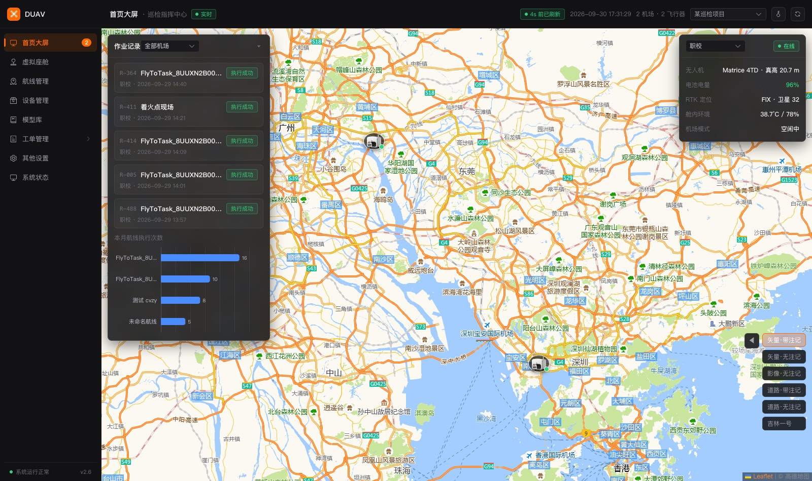
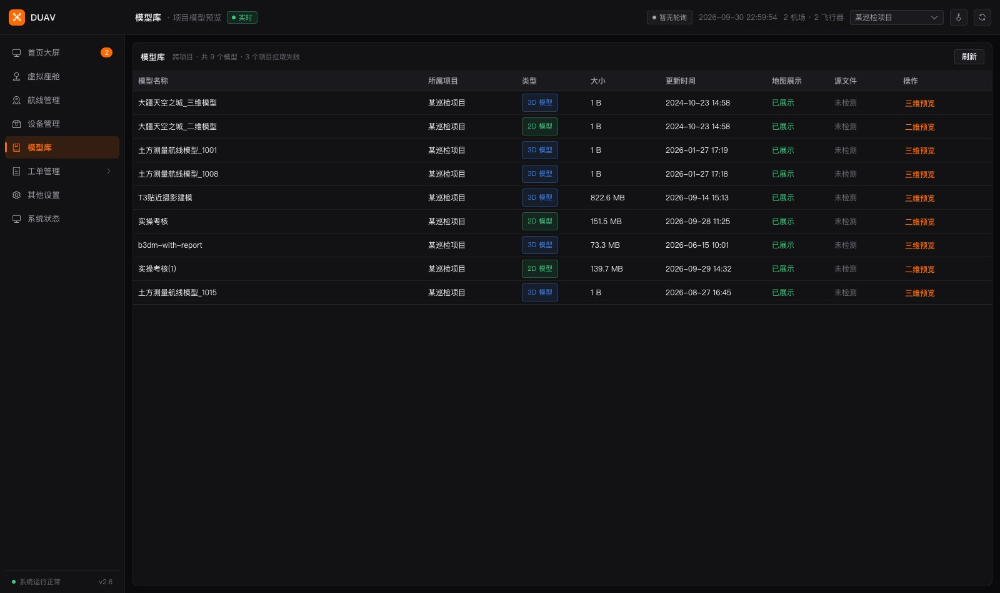
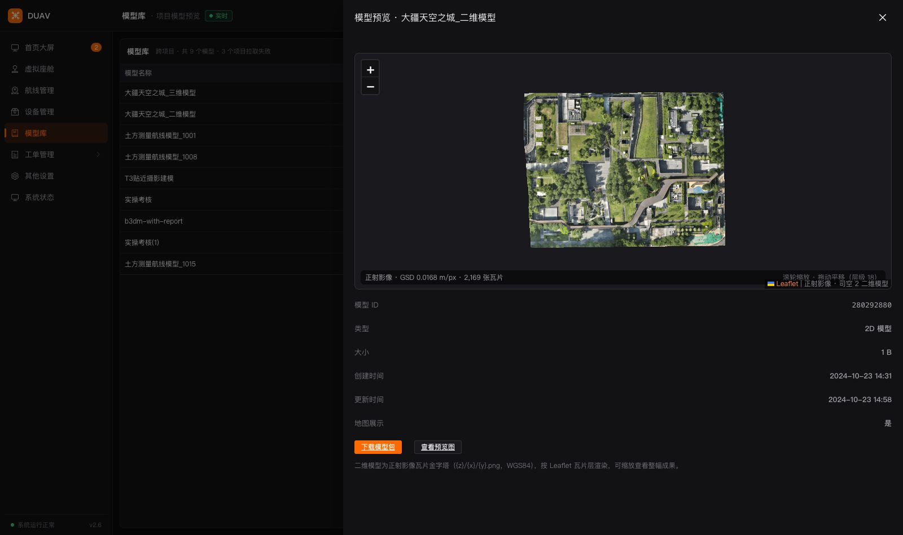
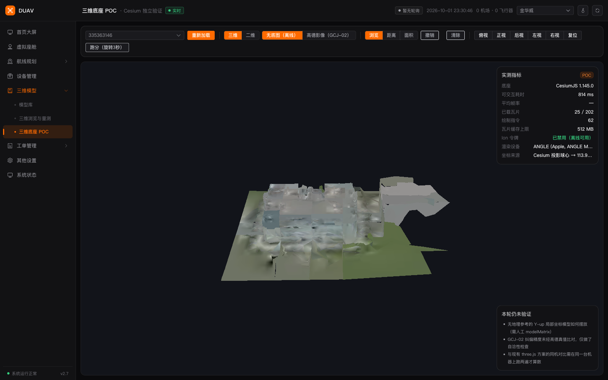
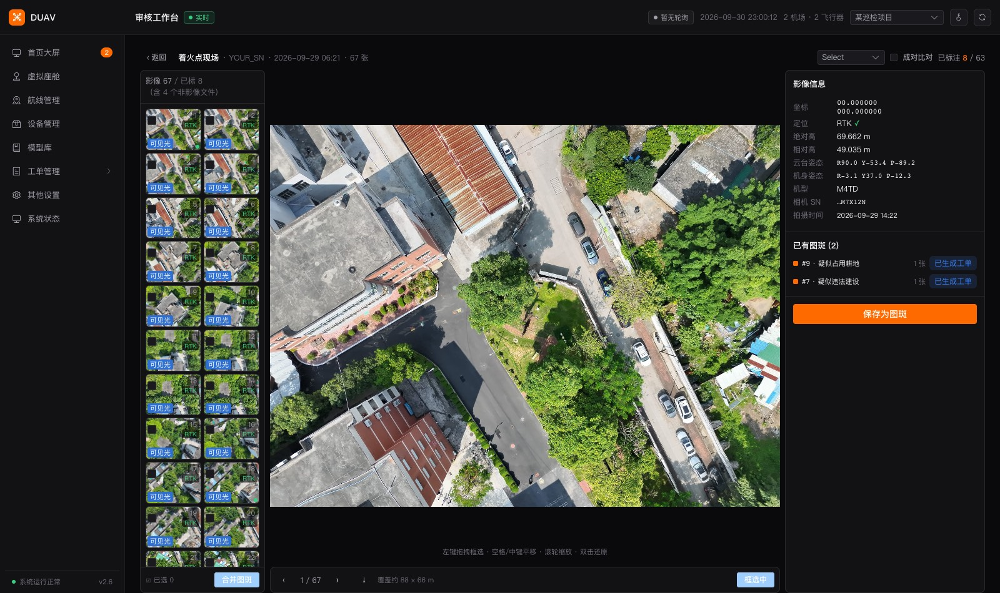
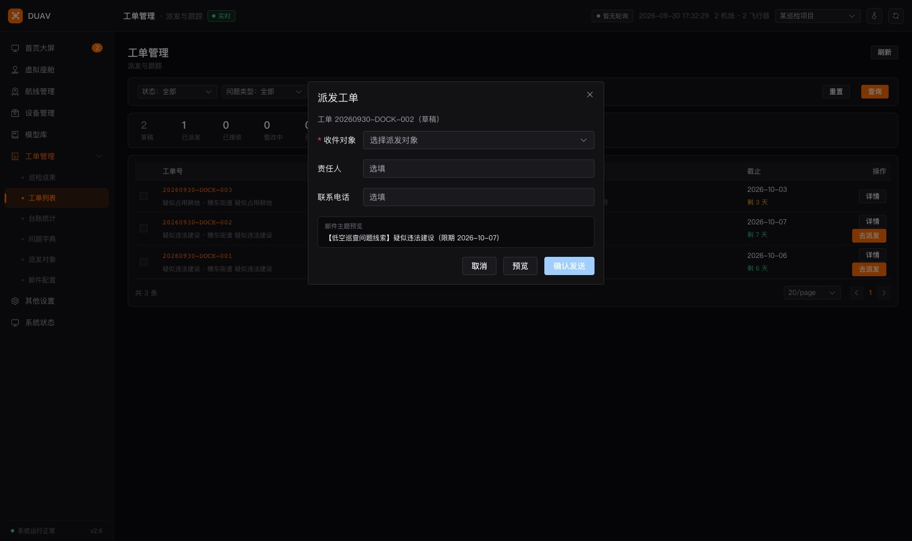
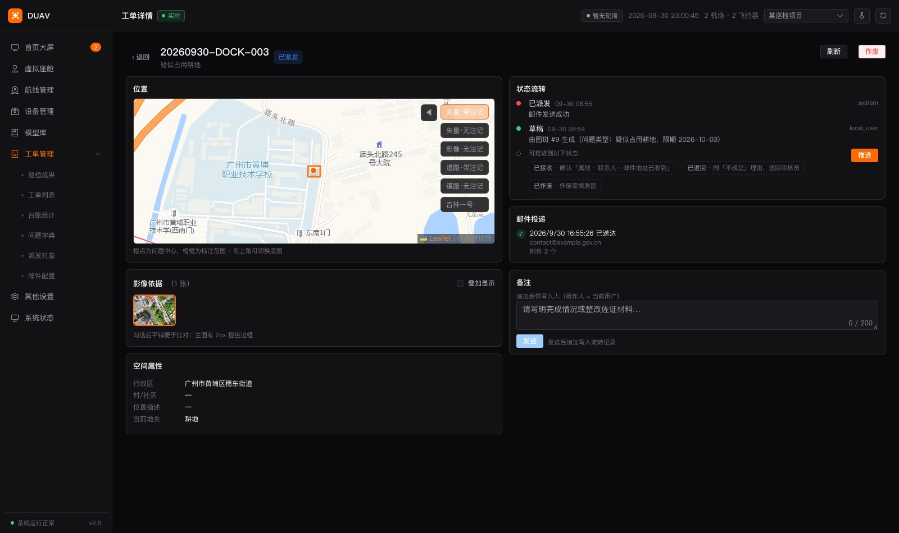

# DUAV · 无人机巡检监管平台（Demo）

> **⚠️ 这是一个基于大疆司空 2（DJI FlightHub 2）OpenAPI 的二次开发 Demo，不是大疆官方产品，也不是可直接交付的生产系统。**
>
> 它验证的是一件事：**司空 2 负责把飞机飞好，我们负责把「空中发现」变成「业务可办」**——
> 即「巡检 → 标记 → 派单 → 整改 → 台账」这条闭环能不能在真实政务场景里跑通。

[](./LICENSE)
[](https://nodejs.org)
]

---

> 🆕 **2026-10-02 更新**
>
> - **接口层加固**：补上统一错误出口（异步异常不再让进程退出）、修复模型库路径穿越、
>   封堵调试代理 SSRF、新增可选接口令牌，并修掉两个「不报错但功能是坏的」死点。
>   详见 [3.5 接口层安全基线](#35-接口层安全基线)；完整排查过程见
>   [代码审查与重构建议](./docs/代码审查与重构建议.md)。
> - **自建航线规划**：多机型适配 + 摆拍收益量化 + GSD/重叠率门禁。
>   注意：OpenAPI **不返回任何镜头光学参数**，光学规格取自 DJI 官方公开数据并逐条标注来源，
>   详见 [3.1](#31-飞行与控制对接司空-2)。
> - 回归脚本增至 **11 个**：后端 `test-db` 91 / `test-flow` 138，
>   航线类 209（`kernel 47 / grid 41 / oblique 76 / integration 45`），
>   守卫类 88（`http-guards 18 / path-safety 24 / security 46`），全部通过。

---

## 一、先说清楚：这个 Demo 的边界

放在最前面，是因为它决定了这个仓库该怎么被使用、被评估。

### 1.1 工单闭环：链路已通，但仍有 Bug，需在真实场景中压测

当前工单模块走通了「**审核影像 → 发现问题 → 生成工单草稿 → 选派发对象 → 邮件送达 → 状态流转 → 台账统计**」，
但它是在**少量真实数据 + 人工构造用例**上验证的，以下问题尚未在真实业务压力下暴露：

| 待验证项 | 现状与风险 |
|---|---|
| 状态机完整性 | 已实现 `草稿 → 已派发 → 已接收 → 整改中 → 已整改 → 待复核 → 通过/退回/作废`，但**除「派发」外的流转基本靠人工在平台点**，没有对接真实责任单位的反馈通道 |
| 送达≠处置 | 邮件发出即视为「已派发」，**收件人是否收到、是否认可、是否整改，系统目前无法感知**，缺少回执与超时升级机制 |
| 责任单位与联系人 | 现为手工维护的字典（名称/邮箱/电话/辖区），**未与客户实际组织架构、政务账号体系对接**，派错对象的风险靠人工兜底 |
| 并发与冲突 | 多人同时审核同一架次、同一图斑被重复标注派单等场景**未做乐观锁与去重** |
| 附件与容量 | 邮件附件走 Base64 内联，**大架次多图时体积不可控**，未做分片/对象存储直链 |
| 权限与审计 | 目前是单组织内部演示级，**没有完整的角色权限与操作审计**，无法直接对政企客户开放 |
| 数据迁移 | 字典、图斑、工单**没有 Excel 批量导入导出**，历史台账无法迁移 |

> 结论：可以拿它做**方案讲解、流程验证、接口联调试点**；**不能**直接当生产系统上线，需按目标客户的组织架构、政务数据接口与合规要求重做后半段。

### 1.2 工单推送：邮件只是其中一种 Demo 实现

当前实现的派发通道是 **SMTP 邮件**（带影像附件 + 位置说明 + 责任单位/联系人），
它只是用来证明「工单能送达、有回执、可追踪」的**最简实现**，不是最终形态。

**理想形态是把工单推送到客户已有的平台里**，因为监管闭环的终点本来就该是客户已有的系统：

| 目标通道 | 说明 | 状态 |
|---|---|---|
| 客户既有政务/监管平台 API | 按对方的工单接口规范推送（图斑属性 + 影像链接 + 处置时限），由客户系统内派发、催办、归档 | ❌ 未实现，需按客户接口定制 |
| **企业微信** | 应用消息 / 卡片消息推送给责任人，附带影像与位置，可直接在企微里回执 | ❌ 未实现 |
| 短信 / 12345 类工单通道 | 应急与超时催办 | ❌ 未实现 |
| 邮件 | 当前唯一通道 | ✅ 已实现（SMTP，可配、可预览、可重试、有投递日志） |

> 换句话说：**邮件是 Demo，企微 + 客户平台接口才是落地形态。**
> 系统的工单数据模型（草稿 / 派发对象 / 责任人 / 时限 / 回执 / 流转日志）已按「通道无关」设计，
> 后续接新通道是新增投递通道，不需要重做业务流。

### 1.3 司空 2 OpenAPI 的开放程度有限

二次开发过程中最真实的体感是：**OpenAPI 能覆盖「飞」和「看」，但覆盖不了「办」**。

| 能力 | OpenAPI 现状 | 本项目做法 |
|---|---|---|
| **手动控制无人机** | ❌ 无实时操纵/姿态控制接口，只有有限的单条实时指令（返航、暂停、恢复等） | 只能执行预设航线，**无法像 Pilot 2 那样手动飞** |
| **手动绘制航线** | ❌ 不提供在线绘图能力，KMZ 航线需在司空 2 或 Pilot 2 侧生成 | 平台**自建规划器生成 KMZ**（见 3.1），也可上传司空 2 侧生成的 KMZ |
| **镜头光学参数** | ❌ `/project/device` 只给机型枚举，**无焦距 / 传感器尺寸 / 像素数** | 机型枚举走接口，**光学规格取自 DJI 官方公开数据并标 source**，见 [3.1](#31-飞行与控制对接司空-2) |
| **智能摆拍（Oblique）** | ❌ 官方只有定性结论，无公式无角度；WPML 字段未经真机验证 | 只做**收益量化与安全下限**，不改航线输出，见 [3.1](#31-飞行与控制对接司空-2) |
| AI 识别 / 算法下发 | ❌ 未开放算法下发与推理结果接口 | 见 1.4 |
| 机载算法 | ❌ 需走 PSDK / 行业应用 | 未涉及 |
| 远程开机 | ❌ 无此接口，飞行器必须现场开机 | 只能现场或起飞任务触发上电 |
| 媒体文件 | 签名约 24h 过期，`HEAD` 探测不可靠 | 每次使用前重签，**原图需落对象存储** |
| 飞行任务列表 | `sn` / `begin_at` / `end_at` 缺参时**不报错但静默返回空列表** | 已封装校验并沉淀为经验 |
| 航线与飞行记录 | 部分字段需逐级下钻、缺参静默成功 | 见 `skills/sikong2-openapi` |
| 影像元数据 | DJI 机型不写标准 EXIF GPS，坐标在 XMP 私有命名空间 | 自研 `djiXmp.js` 解析器（实测 14/14 提取成功） |
| 模型库 | 部分项目/密钥无模型权限会返回 Forbidden | 跨项目聚合，单项目失败不拖垮整体 |
| 三维模型 | 3D Tiles / b3dm 需自行解析与 LOD 策略 | 已实现三维预览；**2D 模型（正射影像）走瓦片层渲染**；点云 pnts 解析已实现但**尚无真实数据验证** |

> **一句话**：飞行能力用司空 2 就够了，**不要在我们平台上重复造飞行能力**；
> 二次开发的价值全部在「发现之后」的那一段。唯一例外是**航线规划**——
> 它属于「任务前」而不是「飞行控制」，且 OpenAPI 明确不提供在线绘图，所以值得自建。

### 1.4 后端引入 AI：需要自建服务器，成本压力巨大

OpenAPI 不开放算法下发与推理结果接口，所以**任何「AI 识别」都只能在我们自己的后端做**：

- 需要**自建 GPU 服务器 / 推理服务 + 模型训练与迭代**，不是加个 SDK 的事；
- 需要自行解决**样本标注、模型精度、正样本稀缺（真实违建案例少）**；
- 需要承担**持续的算力与运维成本**（显卡、机房、模型版本管理、热更新）。

> **成本判断**：对绝大多数市县级低空监管项目，**自建 AI 推理服务是当前性价比最低的一步**。
> 本项目的选择是：**先把「人机协同审核」做顺**（审核员在框选证据上快速定性），
> 待样本积累到一定量级，再评估引入 AI 做**辅助预筛**（而不是自动定案）。
> AI 挂载点已预留在图斑模型上（`overlay_result / overlay_confidence / data_version`），
> 但**界面上不展示未实现的能力**，避免用假数据误导使用者。

---

## 二、这是什么

DUAV 不是「无人机地图大屏」，而是一套**把空中发现转成可派发、可核查、可整改、可复核、可归档的监管流程**的验证系统。

它回答五个问题：

| 问题 | 由什么支撑 |
|---|---|
| **谁在飞** | 设备底账（机场 + 飞行器 + 载荷 + 责任单位） |
| **飞到哪里** | 实时态势、航线库、飞行任务、遥测轨迹 |
| **看见了什么** | 巡检成果（架次聚合 + 原图 + GPS + RTK 状态 + 拍摄姿态） |
| **归谁处理** | 审核工作台 → 问题图斑 → 工单草稿 → 选派发对象 → 送达 |
| **处理完没有** | 状态流转 + 整改闭环 + 台账统计 |

> 💡 **核心观点**：低空监管的价值不是把无人机图标放到地图上，而是把「空中发现」翻译成「业务可办」。
> 卫星看全域、低空看细节、平台管闭环。

---

### 界面一览

> 以下均为**本仓库真实运行截图**（深色主题）。为遵守脱敏约定，截图中的
> **设备 SN、客户项目名、联系方式、精确坐标已在页面内遮蔽**（显示为 `YOUR_SN` / `某巡检项目` 等），
> 影像与地图画面保留——它们本身就是「证据链」这个功能的展示对象。

**① 飞行与设备**（对接司空 2：看得见、控得住）

| 首页大屏 | 虚拟座舱 |
|---|---|
|  |  |
| 架次 / 里程 / 时长 / 在线率等政务指标 | 实时图传（多引擎自适应）、控制权、航线执行、实时指令 |

| 航线管理 | 设备管理 |
|---|---|
|  |  |
| KMZ 自建生成 / 上传 / 下载 / 一键执行 | 机场与飞行器底账、物模型实时状态、HMS 异常 |



> 模型库**跨项目聚合**——不依赖当前项目下有没有设备，单个项目无权限只降级为提示，不影响整体。

**二维模型预览**（正射影像，与三维模型走完全不同的渲染路径）



> 司空 2 的「2D 模型」不是三维瓦片，而是测绘建图产出的**正射影像瓦片金字塔**
> （`{z}/{x}/{y}.png`，标准 Web Mercator XYZ，WGS84）。平台按瓦片层级 z=12–23 渲染，
> 可缩放到 GSD 0.0168 m/px 的原始分辨率，并显示瓦片数与地面采样距离。

**三维底座 POC（Cesium）**——只做验证，不替换现有 three.js 方案



> 这是一条**独立路由 `/models/geo-cesium`，随时可删**，用途只有一个：回答「三维成果页要不要迁到 Cesium」。
> 四个硬指标全部实测通过（16 项断言，`node web/scripts/verify-cesium-poc.mjs` 可复跑）：
> 坐标落位与既有体系一致（差 4.9e-8°，约 0.005 m）、822 MB 模型稳定 60 fps（M1 Pro / ANGLE Metal）、
> 量测口径与独立实现互差 0.11 m / 298 m、断外网仍可加载且单端口可服务（禁 Ion，不依赖任何外部域名）。
> 代价 +7.9 MB（静态资源 6.8 MB + JS gzip 1.1 MB），只进这一条懒加载 chunk，业务页首屏不受影响。
> 结论是**双引擎并存、不全站替换**；完整论证与 go/no-go 门槛见 [Cesium 底座引入论证](./docs/Cesium%20底座引入论证.md)。
>
> ⚠️ 已知偏差：构建产物里 Cesium chunk **实际进了首屏**（`index.html` 出现 modulepreload），
> 与上面「业务页首屏不受影响」的结论不符，属未修复负债，见
> [代码审查与重构建议 · P1-1](./docs/代码审查与重构建议.md)。

**② 监管闭环**（本项目自研部分：发现 → 标记 → 派单 → 台账）

| 巡检成果 | 审核工作台 |
|---|---|
|  |  |
| 架次聚合、影像数/审核进度、跨项目全量 | 影像速览、RTK/姿态/焦距元数据、框选问题范围、逆地理带出行政区 |

| 工单列表 | 选派发对象（不需去详情页） |
|---|---|
|  |  |
| 草稿「去派发」／已选对象「发送」，状态一眼可辨 | 选责任单位自动带出责任人·电话·邮箱，确认后邮件送达 |

| 工单详情 | 台账统计 |
|---|---|
|  |  |
| 真实底图定位 + 标注范围、影像依据、流转时间线、投递日志 | 按行政区 / 时间 / 状态 / 问题类型统计（全组织口径） |


> 派发对象为责任单位字典（名称 / 联系人 / 电话 / 邮箱 / 辖区）。
> **当前推送通道为邮件**——企业微信与客户既有政务平台接口尚未接入，见 [1.2](#12-工单推送邮件只是其中一种-demo-实现)。

---

## 三、当前已实现的能力

### 3.1 飞行与控制（对接司空 2）

| 能力 | 说明 |
|---|---|
| 虚拟座舱 | 机场/飞行器选择、控制权获取与释放、实时直播、作业地图、航线执行、实时指令（返航/暂停/恢复） |
| 多路直播 | 机场舱内/舱外相机、飞行器广角/变焦/红外；**volc / agora / srs 三引擎自适应** |
| 航线管理 | 列表、KMZ 上传（STS 临时凭证 → 对象存储 → 上传通知）、下载、一键创建立即任务 |
| 任务管理 | 列表/筛选、详情、挂起/恢复、媒体资源、飞行轨迹 |
| 设备管理 | 物模型实时状态、HMS 异常、控制权、相机/镜头/清晰度控制 |
| 监管大屏 | 架次、里程、时长、在线率、成功率等政务指标 |
| 最优机巢推荐 | 按目标点与电量需求推荐起降机巢（规则引擎） |

#### 自建航线规划（服务端为主，前端 `航线 → 规划`）

司空 2 不提供在线绘图能力，KMZ 必须外部生成。项目因此自建了一套规划器：
**画多边形 → 选机型 → 给参数 → 出 KMZ**，服务端模块在 `server/src/modules/wayline/`。

| 环节 | 实现 | 边界（写在最前面） |
|---|---|---|
| **多机型适配** | 由 35mm 等效焦距 f 驱动全部几何：`swath = H × 36/f`、航线间距 `= swath × (1 − 旁向重叠)`、航向片基 `= H × 27/f × (1 − 航向重叠)`；**只为本队实际拥有的机型生成航线**（非机队机型直接拦下） | 机型**枚举**必须走 `/project/device`，不许写死；焦距/画幅/像素取自 **DJI 官方公开规格**，每条标 `source`，官方没写的一律留 `null` 并置 `unknown:true`——**不用行业惯例填坑** |
| **光学参数来源** | 公式用本队三条真实航线反演校验过（Matrice 4TD 反演系数 0.644 / 0.653 / 0.714，理论值 36/53 = 0.679） | 接口**不返回焦距、传感器尺寸、像素数**（2026-10-02 实测新组织 100 项目 / 18 设备，脚本可复跑），「从接口拉光学参数」物理上做不到 |
| **镜头选择的真实含义** | WPML 的 `payloadLensIndex` 对可见光**不区分广角/长焦**（本机队真实航线里一律写作 `visable`） | 选镜头体现的是**间距与片基**的差异，**不是让飞机自动切镜头**；界面已明确说明，避免误解 |
| **任务类型** | 正射网格（`mapping2d`，默认俯仰 −90°）、井字形 / `doubleGrid`（倾斜摄影，默认俯仰 **−45°**）、走廊 / `corridor`（单条带状，默认俯仰 −90°） | 俯仰按任务模式给默认值，可手动调整；倾斜摄影没有单独的曝光策略联动 |
| **重叠与 GSD 门禁** | 航向/旁向重叠校验、GSD 计算、航速告警（按相机最小拍照间隔反推是否掉重叠率），所有结论进 `warnings` | 告警是**建议**不是阻断，最终仍需飞手确认 |
| **摆拍（智能摆动拍摄）** | `obliqueModel.js` 量化收益与安全下限：覆盖宽度 `D = W(1−o) + 2ηH·tanθ`，侧摆影像按折扣 η 计入；给出同重叠率下能拉开多少间距 | **三条不可让的纪律**：① 侧摆影像必须打折，不能与正射等价对待；② 正射自身旁向重叠不能突破重建下限（`minSideOrtho` 不可让）；③ 算不出确定值的角度一律外置为可调项，并在结果里标 `assumed:true` |
| **为什么不写进 WPML** | 规划结果里 `applied` 恒为 `false`：WPML 的 `smartObliqueEnable` 未做真机验证，**写未实测字段一旦失效就是整条航带漏拍** | 摆拍只做「参数怎么调」的投影换算，不改生成的航线 |
| **产出链路** | `planner → wpmlBuilder → kmzPacker → ossUpload`（STS 上传 + `finish-upload` 通知），草稿存在本地 SQLite（`wayline_draft`） | 尚未做图纸合法性在司空 2 侧的自动回验 |

> 回归：`kernel 47 / grid 41 / oblique 76 / integration 45`，共 209 项。
> 理论推导与浏览器验证记录见 [井字形航线算法-专家指导与落地](./docs/井字形航线算法-专家指导与落地.md)。

### 3.2 巡检成果（证据链）

| 能力 | 说明 |
|---|---|
| 媒体同步 | 按机场 / 项目 / 时间范围拉取飞行任务产物，自动下载原图 |
| **DJI 影像元数据解析** | 提取 GPS、RTK 定位质量、绝对/相对高度、云台与机身三轴角、飞行器 SN、相机 SN、镜头类型、航线 ID |
| 架次聚合 | 按 `FlightLineInfo` 自动聚合同一次飞行的所有照片 |
| 多光谱配对 | 红外（`_T`）与可见光（`_V`）同架次自动配对 |
| 模型库 | 3D Tiles / b3dm 逐瓦片渲染（三维窗口）；**2D 模型按正射影像瓦片金字塔渲染**（Leaflet 瓦片层，WGS84，z=12–23），均**跨项目聚合**、不依赖当前项目有无设备 |

> **大模型加载策略**（贴近摄影成果动辄 800MB+）：
>
> | 环节 | 做法 | 目的 |
> |---|---|---|
> | 服务端下载 | `stream.pipeline` 边下边写盘 | 避免 `arrayBuffer()` 把整包读进堆内存（OOM 主因） |
> | 服务端解压 | fflate `Unzip` 流式解压，逐文件落盘 | 包与解压产物不同时驻留内存；临时 zip 用完即删，不占双份磁盘 |
> | 上限 | 300 MB → **2 GB**，并加磁盘余量预检 | 862MB 的「T3贴近摄影建模」从此可预览 |
> | 前端 LOD | 按瓦片**投影像素**逐级细化（不用 `geometricError`，司空 2 的值常是 1e10 异常值） | 先出轮廓，细节后台补 |
> | 前端显存 | 按瓦片**字节数**记账（`MAX_GPU_BYTES` 900MB），超限按 LRU 淘汰 | 瓦片大小差异巨大，只限个数（原先 900 个）挡不住爆内存 |
> | GPU 释放 | 卸载/切模型时 `dispose()` 几何体 + 材质 + **纹理**，并 `forceContextLoss()` | 修掉「来回切几个模型就越来越卡」的泄漏 |
> | Draco | 解码器随应用托管在 `/draco/` | 不依赖 gstatic.com，内网/政务外网可用 |
> | KTX2/Basis | 转码器托管在 `/basis/`，`KTX2Loader` 按需挂载 | 模型带 KTX2 压缩纹理时不会白屏 |
> | 点云 pnts | `pnts` 瓦片解析 + `PointsMaterial` 渲染，unsigned byte 顶点色归一化 | LAS 上传后司空 2 会转成 pnts，此前这类瓦片被静默丢弃 |
>
> 专家建议中 `gltf-pipeline` / `@needle-tools/gltf-progressive` 那套**不适用**：
> 它们针对单个 glTF 文件做压缩与渐进加载，而我们拿到的是**3D Tiles 瓦片包**，
> 压缩与渐进要由生产侧（司空 2 建模导出）完成，运行时只能靠 LOD + 显存预算。

> ⚠️ **重要技术特性**：DJI 机型（M4TD 等）**不写标准 EXIF GPS IFD**，GPS 全部存放在 XMP 的 `drone-dji` 私有命名空间，
> 通用 exif 库会返回 `null`。本项目内置专用解析器，实测 **14/14 张 RTK 级坐标提取成功**。
> 详见 [`server/src/modules/asset/djiXmp.js`](./server/src/modules/asset/djiXmp.js)。

### 3.3 审核与工单闭环

| 能力 | 说明 |
|---|---|
| 审核工作台 | 从「巡检成果 → 审核影像」进入；按架次浏览、地图定位、**框选问题范围**、判定问题类型、逆地理带出行政区 |
| 图斑 | 空间载体，可独立存在（`geometry` + 影像关联 + 空间属性 + 逆地理地址） |
| 工单草稿 | 审核保存后**只生成草稿**；**在工单列表点「去派发」选择责任单位/责任人/电话后才真正派发** |
| 派发对象维护 | 责任单位字典（名称 / 联系人 / 电话 / 邮箱 / 辖区），选中对象时自动带出联系人 |
| 工单状态流转 | 草稿 → 已派发 → 已接收 → 整改中 → 已整改 → 待复核 → 通过 / 退回 / 作废，附流转日志与备注 |
| 邮件投递 | SMTP 配置、模板预览、队列重试、投递日志（耗时/状态/错误） |
| 台账统计 | 按行政区、时间、状态、问题类型统计，ECharts 图表 |

> **两条产品取舍**（写在代码里也写在这里）：
> 1. **不给「估算面积」**——航拍 GSD / 相对高度误差大，宁可不给数字也不给假数字。
> 2. **运营模块跨项目**——巡检成果 / 工单 / 台账看的是**全组织数据**，不随顶部项目切换而清空。
> 3. **无影像证据不可派单**——没有证据的线索不进入处置流程。

### 3.4 系统管理

- **多组织 TK 切换** / **多接入点**（国内 / 海外 / 私有云）/ **API 测试器**
- **邮件配置**（SMTP）/ **问题字典** / **派发对象** / **系统状态**（同步与告警）
- **实时日志** — SSE 推送，原始 `code`/`message`/耗时可见
- **演示模式** — 无 TK 时以本地 mock 数据启动

### 3.5 接口层安全基线

2026-10-02 做的一轮**接口层加固**（起因与完整清单见 [代码审查与重构建议](./docs/代码审查与重构建议.md)）。
这一节的每一条都有对应的回归脚本，改代码后务必重跑。

| 项 | 加固前 | 加固后 |
|---|---|---|
| 异步异常 | Express 4 不接管 async handler 的 rejection，路由里 60 余处 async handler 裸奔（审查口径 48 个路由）；任一设备网络抖动 → **unhandled rejection 杀进程**，请求方永远挂起 | `server/src/http.js` 的 `hardenRouter()` 在挂载时一次性包裹 14 个 Router 的全部 async handler，统一交给 `errorHandler` 落成 500 JSON；另有 process 级守卫兜底 |
| 模型库路径穿越 | 越界校验以「由未校验 `id` 构造的目录」为基准，`id` 未校验使基准本身逃出根目录 → 校验恒真，可读取 `data/tokens.json`（**明文 TK**） | id 白名单 + 基准恒为 `CACHE_ROOT` + `realpath` 三重校验，并在 `router.param('id')` 层统一收口（远端查询路由一并过滤） |
| 调试代理 SSRF | `/api/admin/proxy` 接受任意 path，配合自定义接入点可把真实 TK 发往任意地址 | `server/src/security.js`：路径限 `/openapi/` 前缀；上行地址拒绝内网 / 本机 / 云元数据段（私有云内网场景用 `PROXY_ALLOW_PRIVATE=1` 显式放行，但 link-local 段无条件拒绝） |
| 接口鉴权 | 全站无鉴权 | 可选令牌中间件：设置 `API_TOKEN` 后全站校验，支持 Header / Bearer / query 三种携带方式 |
| 两个「静默失效」的功能 | 「演示数据」开关因未导入 `adminApi` 而 ReferenceError；`refreshOverdue()` 定义了却全仓无调用点，导致 `overdue` 恒为 0、逾期统计与筛选失效且**不报错** | 均已接线，并补上反向回收（期限后延或已进终态不再算逾期） |

> ⚠️ **安全默认值没有变化**：不设 `API_TOKEN` 时接口依旧无鉴权。
> 这是为了不打乱本地/局域网单端口部署的现状——**对外暴露前必须先设置它**。

**已知未做**（按优先级，详见审查报告）：Cesium chunk 实际进首屏、三处 N+1 查询、
`{ok}` 与 `{code}` 两套响应信封并存、吉林一号底图 key 明文在产物里、大组件（>500 行）未拆分。
文档里有明确的建议执行顺序，可按迭代节奏接手。

---

## 四、技术栈

| 层 | 选型 |
|---|---|
| 前端 | Vue 3 · Vite · Pinia · Vue Router · Element Plus · Leaflet · ECharts |
| 三维 | three.js（业务三维预览）· CesiumJS（独立 POC 路由）· Draco / KTX2 解码器本地托管 |
| 地图 | 高德矢量/影像、吉林一号瓦片，WGS84 → GCJ-02 纠偏 |
| 直播 | `@volcengine/rtc`（火山）· `agora-rtc-sdk-ng`（声网）· 原生 WebRTC WHEP（SRS） |
| 后端 | Node.js · Express，统一注入 `X-User-Token / X-Project-Uuid / X-Request-Id / X-Language` |
| 接口层 | `src/http.js`（异步异常兜底、统一错误/404 出口）· `src/security.js`（鉴权、SSRF 防线） |
| 存储 | SQLite（业务库）· `ali-oss` + STS 临时凭证（航线上传与原图） |
| 影像解析 | 自研 XMP `drone-dji` 解析器，零外部依赖 |

**后端分层**：

```
http.js      统一错误出口 / async 包裹 / 404 兜底
security.js  访问令牌 / SSRF 防线 / 代理路径白名单
routes/      薄路由：契约与校验
modules/     业务模块：drone（飞行/设备/直播/航线）· asset（成果资产）· review（审核/图斑）
             ticket（工单）· notify（邮件/队列/告警）· geo（逆地理）· wayline（航线规划）· system
db/          SQLite + migrations + repositories（ticket / patch / asset / dict …）
```

---

## 五、快速开始

```bash
# 1. 启动后端（端口 8787，同时托管前端 dist）
cd server && npm install && npm run dev

# 2. 开发模式：另起前端（端口 5173，热更新）
cd web && npm install && npm run dev

# 3. 打开 http://localhost:5173（或直接访问 8787）
```

**TK 需要自备**，仓库不含任何内置密钥。两种方式二选一：

1. 启动后在「其他设置 → 添加 TK」中粘贴
   （路径：大疆司空 2 → 我的组织 → 组织设置 → 云端互联 → 组织密钥）
2. 启动时用环境变量注入：`FH2_TOKEN=你的组织密钥 npm run dev`

> 无 TK 时平台以**演示模式**启动（接口走本地 mock），可直接演示 UI。
> 邮件派发需在「其他设置 → 邮件配置」填 SMTP（可用 QQ 邮箱授权码试验）。

### 环境变量

| 变量 | 默认值 | 说明 |
|---|---|---|
| `FH2_TOKEN` | 空 | 司空 2 组织密钥（JWT，需三段完整）。留空则走演示模式 |
| `FH2_BASE` | 空 | 私有云接入点基址，作为 `custom` 接入点的默认值 |
| `PORT` | `8787` | BFF 端口，同时托管前端静态资源 |
| `API_TOKEN` | 空 | **接口访问令牌**。设置后全站校验；不设则无鉴权（见 [3.5](#35-接口层安全基线)） |
| `CORS_ORIGIN` | 空 | 允许的来源白名单，逗号分隔；留空保持开发期宽松行为 |
| `PROXY_ALLOW_PRIVATE` | 空 | 设为 `1` 才允许调试代理访问内网地址（私有云场景），link-local 段仍拒绝 |
| `SMTP_USER` / `SMTP_PASS` | 空 | 邮件派发凭据；缺任一则该功能不可用，服务正常启动 |
| `SEED_SAMPLE_RECIPIENTS` | `1` | 设为 `0` 时不灌入示例派发对象 |

**推荐体验路径**：

```text
# 监管闭环
巡检成果 → 审核影像 → 框选问题 → 保存并生成工单草稿
        → 工单列表 → 去派发（选责任单位）→ 确认发送 → 工单详情 / 台账统计

# 航线规划
航线 → 规划：画多边形 → 选机型 → 给参数（注意 warnings）→ 生成 KMZ → 上传 → 一键创建任务
```

---

## 六、项目结构

```
duav/
├── README.md                  本文档
├── ARCHITECTURE.md            架构设计（数据流、时序、接口清单、联调结论）
├── docs/
│   ├── ARCHITECTURE-v2.md     政务版信息架构与后端分层
│   ├── Cesium 底座引入论证.md  三维引擎选型的 go/no-go 论证
│   ├── 井字形航线算法-专家指导与落地.md
│   ├── 广东省域大屏-技术论证.md
│   └── 代码审查与重构建议.md   全仓审查：已修 / 待修 / 保留项清单
├── server/                    后端 BFF :8787
│   ├── src/
│   │   ├── index.js           应用入口、路由挂载、SSE、静态托管
│   │   ├── http.js            错误出口 / 异步包裹 / 404 兜底 / 进程守卫
│   │   ├── security.js        访问令牌 / SSRF 防线 / 代理路径白名单
│   │   ├── djiClient.js       司空 2 统一网关（鉴权、超时、safeParse）
│   │   ├── logger.js          环形日志缓冲 + SSE
│   │   ├── routes/            session device live wayline task model asset
│   │   │                      review ticket notify dict admin ops takeoff
│   │   ├── modules/           drone · asset · review · notify · geo · system
│   │   │   └── wayline/       planner · routePlanner · cameraGeometry
│   │   │                      aircraftLens · obliqueModel · lensProfile
│   │   │                      wpmlBuilder · wpmlInspector · kmzPacker · ossUpload
│   │   └── db/                SQLite / migrations / repositories
│   └── scripts/               probe-*.mjs 接口探针 · test-* 业务回归 · verify-* 专项验收
├── web/                       前端 SPA
│   ├── src/views/             大屏 座舱 航线 设备 模型 巡检成果 审核工作台
│   │                          工单列表/详情 台账 其他设置(admin)
│   ├── src/components/        BaseMap 播放器 模型查看 日志 通用组件
│   ├── src/api/               dji.js（司空 2）· duav.js（业务）· http.js
│   └── scripts/               verify-*.mjs 端到端验收脚本（Playwright）
├── skills/sikong2-openapi/    司空 2 联调经验 Skill
├── tools/                     sanitize.mjs 脱敏 · check-secrets.mjs 扫描 · shoot-screenshots.mjs
└── tests/full-test.sh         回归入口
```

---

## 七、回归与验收

### 服务端

```bash
cd server

# 数据底座与业务流程
npm run test:db          # 91 项：迁移 / 仓储 / 索引 / 健康检查
npm run test:flow        # 138 项：工单状态机 / 图斑 / 字典 / 逾期刷新
npm run test:mail        # 邮件队列与重试

# 航线规划（纯计算，无需服务与 TK）
npm run test:wayline     # 47 项：规划内核
npm run test:grid        # 41 项：网格几何
npm run test:oblique     # 76 项：摆拍模型与安全下限
npm run test:wayline-int # 45 项：机型/镜头/摆拍集成

# 接口层与安全基线
npm run test:guards      # 18 项：异步异常兜底、统一错误出口、404 兜底
npm run test:path-safety # 24 项：模型库路径穿越（含符号链接逃逸）
npm run test:security    # 46 项：访问令牌、SSRF 防线、代理路径白名单
```

### 前端

```bash
# 真实浏览器端到端（playwright-core + 本机 Chrome），需先启动服务
cd web/scripts
node verify-cesium-poc.mjs      # Cesium 底座 POC 四项硬指标
node verify-nav-group.mjs       # 导航与路由
node verify-review-entry.mjs    # 审核入口与表单
node verify-dispatch-gate.mjs   # 审核→草稿→派发门槛
node verify-dispatch-flow.mjs   # 草稿→选对象→送达全链路
node verify-wayline-plan.mjs    # 航线规划
node verify-model-2d.mjs        # 二维模型正射影像瓦片预览
node verify-screen.mjs          # 大屏
```

> `verify-*` 走真实浏览器，找不到 Chrome 时自动跳过并以 0 退出；测试数据结束后自动清理。

```bash
# 重新生成上文截图（页面脱敏后输出到 docs/screenshots/，需服务已启动）
node tools/shoot-screenshots.mjs
```

> 截图脚本会**先在页面里遮掉设备 SN / 客户项目名 / 联系方式 / 坐标再拍照**，
> 新增页面后请一并补进 `tools/shoot-screenshots.mjs` 的 `SHOTS` 列表，避免文档配图与代码脱节。

---

## 八、配套开发经验 Skill

联调经验已沉淀为可复用 Skill：[`skills/sikong2-openapi/`](./skills/sikong2-openapi/)：

- 鉴权与组织切换的坑（TK 截断、接入点错配、缓存串味）
- 设备 / 物模型 / 控制权（DELETE + JSON Body、SN 校验）
- 图传直播三引擎适配与计费红线
- KMZ 航线上下行
- 飞行任务记录（缺参静默返回空列表）
- 媒体下载（签名 24h 过期、XMP GPS 解析）
- 3D Tiles / b3dm 解析与 LOD 策略
- 脱敏清单

附 `references/api-cheatsheet.md`（接口速查）与 `references/error-codes.md`（错误码与现象对照）。

---

## 九、常见问题

| 现象 | 处理 |
|---|---|
| 所有接口返回 `401 未授权` | 环境变量设置了 `API_TOKEN`。请求带 `X-Access-Token` 头（或 `Authorization: Bearer`，SSE 场景可用 `?access_token=`）；不需要鉴权就取消该变量 |
| 接口返回 **404 JSON**（正文是 `接口不存在: GET /api/xxx`） | 先前这类请求会拿到 SPA 的 HTML 并被前端当成解析错误。现在路径明确 404，请核对 URL；路由清单见 `server/src/index.js` |
| 请求挂起很久后返回 500 JSON | 说明某个 async 路由抛了异常并被统一出口接住（日志 `HTTP` tag 会记录），进程不再退出。500 的 `message` 里就是原始错误信息 |
| `200401 Unauthorized` / `token validation failed` | TK 与接入点不匹配。在「其他设置 → 接入点」切换 国内/海外/私有云后重新体检；或在司空 2 重新生成组织密钥。TK 是 JWT，需三段完整 |
| 调试代理提示「不允许的路径」或「当前接入点不可用」 | 代理路径必须以 `/openapi/` 开头；上行地址不允许内网/本机/元数据段。私有云内网请先设 `PROXY_ALLOW_PRIVATE=1` |
| 控制权获取 `Bad Request` | `drone_sn` 必须是**飞行器 SN**（不是机场 SN），`payload_index` 必须是数组，如 `["81-0-0"]` |
| 控制权释放 `internal server error` | 释放接口是 **DELETE + JSON Body**，需与获取时的 payload 一致 |
| 直播播放失败 | 司空 2 动态选择供应商（volc / agora / srs），本平台三引擎自适应。用「API 测试」直连 `/openapi/v0.1/live-stream/start` 查看原始 `url_type` 与 `url` |
| 飞行器镜头相关操作失败 | 飞行器**必须开机**才有 `camera_list`。司空 2 无远程开机接口，需现场开机或创建起飞任务触发上电 |
| 航线规划提示「非本机队机型」 | 规划器只为 `/project/device` 里实际存在的机型生成航线，先在「设备管理」确认该机型已入账 |
| 地图无机场 / 飞机 | 坐标来自物模型 `/device/{sn}/state`，需设备在线且已选择正确项目 |
| 媒体 URL 返回 403 | 媒体签名有效期约 24 小时。**每次使用前重新取签名，不要缓存 URL**；探测用 `GET + Range: bytes=0-0`，不要用 `HEAD` |
| 影像读不出 GPS | DJI 机型不写标准 EXIF GPS，请用 `modules/asset/djiXmp.js` 解析 XMP；且必须用**原图**，缩略图已剥离元数据 |
| 航线上传失败 | 需已选择项目（STS 凭证按项目发放），文件为 .kmz，压缩包内只含 `wpmz/template.kml` + `wpmz/waylines.wpml` |
| 飞行任务列表为空但确实飞过 | `/flight-task/list` 的 `sn` / `begin_at` / `end_at` 为**必填**，缺参数不报错但静默返回空列表，`sn` 用**机场 SN** |
| 模型库显示「N 个项目拉取失败」 | 部分项目/密钥无模型权限会返回 Forbidden，属正常现象；平台已改为跨项目聚合并把失败降级为提示 |
| 台账「逾期数」一直是 0 | 已修复（`refreshOverdue` 此前全仓无调用点）。逾期在每次读台账前刷新，60 秒节流一次 |

---

## 十、安全与脱敏

```bash
node tools/sanitize.mjs        # 批量替换 JWT / 设备 SN / 项目 UUID 为 YOUR_XXX 占位符
node tools/check-secrets.mjs   # 扫描残留敏感信息，有问题时以非 0 退出
```

**仓库内不包含任何真实组织密钥、设备 SN、项目 UUID、客户名称与坐标。**
`.gitignore` 已排除 `server/data/`（含 `tokens.json` 与本地 DB）、`docs/api/`、`node_modules/`、`web/dist/`、`.env*`。

**对外部署前的三件事**（其余均为可选加固）：

1. **设置 `API_TOKEN`** —— 默认全站无鉴权，这是当前最大的暴露面；
2. **设置 `CORS_ORIGIN`** —— 收敛跨域来源，不要长期依赖宽松 CORS；
3. **把 TK 放进环境变量** —— 组织密钥（TK）只通过 `FH2_TOKEN` 注入，
   **不要**写入源码、前端、日志、截图或 commit。

已知剩余的安全口子见 [3.5 已知未做](#35-接口层安全基线)，其中「吉林一号底图 key 明文在构建产物里」
在对外发布前应当处理。

---

## 十一、许可证与声明

[MIT](./LICENSE)

本项目为**独立实现的二次开发 Demo**，与 DJI 无隶属关系，非大疆官方方案或产品。
大疆司空 2 / FlightHub 2 为大疆创新（DJI）旗下产品，其 API 能力边界以官方文档为准。

文中的镜头光学参数（焦距 / 画幅 / 像素）取自 DJI 公开规格，摆拍收益模型为**本项目自行推导**，
不代表大疆的承诺；航线可否执行以实际飞行验证为准。

文中提到的政务平台、企业微信、工单闭环形态等为**产品规划方向**，不代表已实现能力；
一切以本仓库代码为准。
