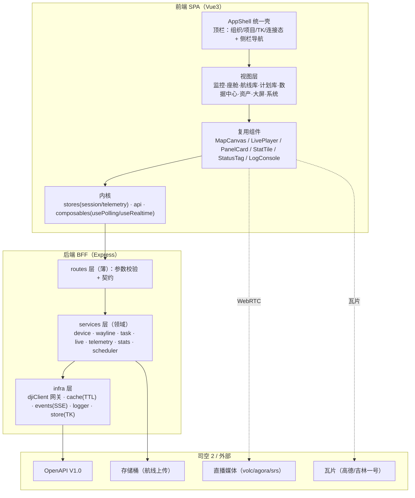

# 一网统飞 · 无人机巡检政务平台 架构重构方案 V2

> 依据：①《大疆司空 2 使用说明》（481 页，2026-09 版）②司空 2 OpenAPI V1.0（104 份 Apifox 文档）③一网统飞市级低空监管/巡检业务模型
> 目标：把「司空 2 接口 Demo」重构为「**一网统飞无人机巡检政务平台**」——多部门共用机场资源、统一航线库、统一计划派发、统一成果归集与监管。

---

## 一、为什么要重构：三类差距

| 维度 | V1（当前）现状 | V2 目标 |
|---|---|---|
| 语义 | 用的是接口术语（device/wayline/flight-task） | 用**司空 2 业务术语**（组织/项目/航线库/计划库/媒体库/驾驶舱）并叠加**政务术语**（部门/网格/工单/事件） |
| 架构 | 路由直连司空 2，无缓存无领域层 | 分层：`routes → services → gateway`，含**遥测缓存 / 事件总线 / 状态机 / 调度器** |
| UI | 六页并列，各自为战 | **地图为核**的统一壳：监控 → 座舱 → 航线库 → 计划库 → 数据中心 → 资产 → 监管大屏 → 系统管理 |

---

## 二、能力边界（来自说明书，决定平台能做什么）

### 2.1 司空 2 原生能力（OpenAPI 可对接部分）

| 司空 2 模块 | 平台对应 | OpenAPI 支撑度 |
|---|---|---|
| 组织 / 项目 / 成员角色 | 组织与项目上下文 | ✅ 项目列表、项目设备、添加人员 |
| 机场（Dock 1/2/3）、地面站、飞行器 | 设备资产 | ✅ 设备列表、物模型、HMS、控制权、相机/镜头、图传清晰度 |
| 航线库（航点/面状/斜面/几何体/贴近摄影） | 航线库 | ✅ 列表/详情/上传/下载（上传需 STS） |
| 计划库（立即/单次定时/重复定时/连续；蛙跳；断点续飞） | 计划库 | ✅ 创建任务、状态更新（挂起/恢复）、任务列表/详情/媒体/轨迹 |
| 驾驶舱（虚拟座舱） | 虚拟座舱 | ✅ 直播（volc/agora/srs）、控制权、实时指令（返航/暂停/恢复） |
| 媒体库 / 模型库 / 标注 | 数据中心 | ✅ 任务媒体、模型列表/详情/下载、创建地图标注 |
| 告警 / HMS / 空域告警 | 告警中心 | ✅ HMS 接口（空域告警仅端侧，OpenAPI 无） |
| 直播分享 / RTMP 转发 | 直播转推 | ⚠️ 旁路推流仅私有云；RTMP 转发端侧配置 |

### 2.2 OpenAPI **做不到**的（必须在平台侧自建或标注）

- 航线**编辑/规划**（编辑器、Copilot 航线 Agent）：平台只做库管理，规划在司空 2 端完成
- AI 识别（人/车/船、多模态搜索、变化检测 Pro）、分析器：端侧能力，平台做**结果归集与展示位**
- 空域/限飞/地形障碍物：端侧，平台侧预留**空域圈 + 网格**数据结构
- 自动化工作流（采集→重建→量测→报告）：平台侧自建编排（用现有任务 + 模型接口串联）

### 2.3 一网统飞政务增量（平台自建，不依赖司空 2）

- **部门/网格/巡检区域**：把项目映射为"部门业务域"，把标注/面映射为"巡检网格"
- **最优机巢调度**：按航线起降点 + 机场状态 + 续航 + 距离推荐机场（规则引擎，见 §5）
- **工单/事件闭环**：告警 → 派发复飞 → 结果归档
- **监管大屏**：架次/里程/时长/覆盖率/在线率/任务成功率/告警数，按部门与时间维度
- **审计与配额**：直播时长、建图张数、存储（组织套餐维度，来自说明书 §套餐）

---

## 三、重构后的分层架构



### 3.1 目录结构（重构后）

```
server/src/
├── routes/          // 只做契约与校验
├── services/        // 领域服务（新增，核心）
│   ├── deviceService.js   设备树 + 物模型 + 状态归一化 + 坐标
│   ├── telemetry.js       统一遥测快照（供监控/座舱/大屏复用）
│   ├── waylineService.js  航线库（列表/详情/上传/下载/类型映射）
│   ├── taskService.js     计划库（创建/列表/详情/状态机/统计）
│   ├── liveService.js     直播（开启 + 供应商鉴权解析策略）
│   ├── statsService.js    一网统飞指标（架次/里程/时长/在线率/成功率）
│   └── scheduler.js       最优机巢推荐 + 巡检计划编排
├── infra/
│   ├── djiClient.js       网关（鉴权头/超时/安全解析）
│   ├── cache.js           TTL 缓存（降频，防 429/限流）
│   ├── events.js          事件总线 + SSE
│   ├── logger.js          日志环形缓冲
│   └── store.js           TK 持久化
└── mock.js                 演示数据模式

web/src/
├── layout/AppShell.vue     统一壳（顶栏 + 侧栏 + 连接态 + 项目切换）
├── styles/tokens.css       设计令牌（颜色/间距/字号/阴影）
├── components/             复用组件（MapCanvas/LivePlayer/PanelCard/StatTile/StatusTag/LogConsole/EmptyState）
├── stores/                 session（组织/项目/TK）· telemetry（遥测缓存）
├── composables/            usePolling · useRealtime(SSE)
└── views/                  Monitor · Cockpit · Wayline · Plan · DataCenter · Assets · Dashboard · Admin
```

---

## 四、领域模型（统一语义）

| 实体 | 关键字段 | 来源 |
|---|---|---|
| Organization | orgUuid、name、TK、接入点 | JWT 解析 + TK 仓库 |
| Project（业务域/部门） | uuid、name、中心点、设备列表 | `/project` |
| Device（机场） | sn、callsign、model、online、mode、cameraList、位置、projectUuid | `/device` + 物模型 |
| Device（飞行器） | sn、callsign、model、online、mode、lens、电量、dockSn | 同上 |
| Wayline（航线库） | id、name、templateTypes、updateTime、downloadUrl | `/wayline`、`/wayline/{id}` |
| FlightTask（计划库） | uuid、name、status、type、sn、wayline、时间、媒体、轨迹 | `/flight-task/*` |
| Telemetry（遥测快照） | 位置、高度、电量、模式、HMS、在线 | 物模型聚合，**TTL 缓存 10s** |
| Alert（告警） | level、module、message、device、时间 | HMS + 任务失败码 |
| Grid（巡检网格） | 几何、归属部门、绑定航线 | 平台自建（标注/GeoJSON） |

**状态机**：任务 `waiting → executing → (paused) → success / terminated / starting_failure / timeout`；设备 `offline / idle / preparing / working / returning / upgrading`。平台统一归一化（同时兼容司空 2 的数字码与字符串枚举）。

---

## 五、核心服务设计

### 5.1 telemetry（统一遥测快照）
一次聚合：设备树 + 物模型 + 位置 + 电量 + HMS，输出给监控页、座舱、大屏、地图复用，**避免每个页面各拉一遍**（V1 的主要性能问题）。TTL 10s 缓存，SSE 推送变更。

### 5.2 scheduler（最优机巢推荐）
输入：航线起降点/目标网格 + 候选机场（在线、空闲、绑定飞行器在舱）。
规则：① 机场在线且空闲 ② 直线距离 ≤ 续航半径（按机型标定，如 M4TD 约 7km 作业半径）③ 电量 ≥ 阈值 ④ 无 HMS 严重告警 ⑤ 距离最近优先。
输出：推荐机场 + 评分明细（可解释，政务场景必须可解释）。

### 5.3 liveService（供应商策略）
`url_type` → `volc | agora | srs | demo`；参数解析同时支持 http URL 与 `app_id=..&room_id=..&token=..&user_id=..` 参数串；返回统一 `{engine, appId, roomId, token, userId, expireTs}`。

### 5.4 statsService（监管指标）
架次、飞行时长、里程（轨迹 `flight_distance/flight_duration`）、在线率、任务成功率、告警数、覆盖网格数；按项目/时间维度聚合，供大屏与总览看板。

---

## 六、UI 信息架构（重构后）

| 导航 | 页面 | 核心内容 |
|---|---|---|
| 飞行监控（首屏） | Monitor | **地图为核**：机场/飞行器实时位置、航线、网格、空域圈；右侧设备与任务实时列表；底部直播宫格入口 |
| 虚拟座舱 | Cockpit | 直播（机场舱内/舱外 + 飞行器镜头）、控制权、遥测、指令、航线执行 |
| 航线库 | Wayline | 航线卡片/列表、类型筛选、上传（STS）、下载、下发为计划 |
| 计划库 | Plan | 计划列表（立即/定时/重复/连续）、创建向导、状态机操作、媒体与轨迹 |
| 数据中心 | DataCenter | 任务媒体、模型、标注、导出 |
| 设备资产 | Assets | 机场/飞行器/载荷台账、HMS 告警、运维动作、固件与状态 |
| 监管大屏 | Dashboard | 一网统飞指标（部门维度）、趋势、甘特/分布 |
| 系统管理 | Admin | TK 与接入点、项目、API 测试器、日志、演示模式 |

**设计系统**：`tokens.css` 统一色板（深空蓝 + 政务蓝高亮）、间距、圆角、状态色；组件层统一 `PanelCard / StatTile / StatusTag / EmptyState`，页面只写业务，不再各写样式。

---

## 七、迁移与兼容

- 路由 API 契约保持不变（前端 `api/dji.js` 不动即可切换后端实现）
- 后端 routes 逐步改为调用 services，行为等价 + 新增缓存能力
- 演示数据模式保留，保证 TK 失效时全平台可演示
- 每次重构后跑 `tests/full-test.sh` 全量回归（62 项断言）

---

## 八、OpenAPI 实测踩坑清单（真实环境验证，务必遵守）

> 这些结论都来自真机差分探针（`server/scripts/probe-flight-task*.mjs`，用假 SN 探测，不会真实起飞），
> 文档里没写，但服务端就是这么校验的。

| 接口 | 坑 | 正确做法 |
| --- | --- | --- |
| `POST /flight-task` | 漏传 `resumable_status` → `200610 invalid param format` | 必传，取值 `auto` / `manual` |
| `POST /flight-task` | 传 `landing_dock_sn`（与 `sn` 相同）→ `200101 param is invalid` | 非蛙跳任务禁止传 |
| `POST /flight-task` | 航线 `device_model_key` ≠ 机场内飞行器机型 → `200610` | 预检阶段比对，不匹配直接阻断 |
| `POST /flight-task` | `time_zone` 文档示例必带 | 统一传 `Asia/Chongqing` |
| `GET /wayline` | 列表项的 UUID 字段是 **`id`**，不是 `uuid` | 前端取值用 `row.id` |
| `GET /project` | `usage=simple` 会漏项目 | 固定 `page=1&page_size=100` |
| `POST /device/control` | `drone_sn` 必须是飞行器 SN，`payload_index` 必须是数组 | 飞行器离线时 `camera_list` 为 null，回退机场 `165-0-7` |
| `DELETE /device/control` | 释放控制权必须 DELETE + JSON Body | 走 `deleteWithBody` |
| `POST /live-stream/start` | 飞行器**关机**时开播 → `213003 no streaming gateway found` | 图传通道不存在，必须先开机 |
| 飞行器开机 | **没有任何远程开机接口**：`获取控制权` 不上电（实测 20 分钟仍离线）；`debug-mode-open` 公有云 **404**（v1.0/manage 仅私有云） | 要图传只能先飞任务或现场开机；关机时看机舱内的飞机用**机场舱内相机** |
| `GET /project/device` | 飞行器 `camera_list` **开机后才有**（文档原话） | 关机时为 null，不要据此伪造选项 |
| `GET /device/{sn}/state` | 设备列表不含坐标 | 坐标只从物模型取（飞行器回退 `home_*`） |

统一入口：`modules/drone/services/flightTaskBody.js` 的 `buildFlightTaskBody()`，
所有创建飞行任务的路径（一键起飞 / 航线库 / 任务管理）都必须走它，避免重复踩坑。
